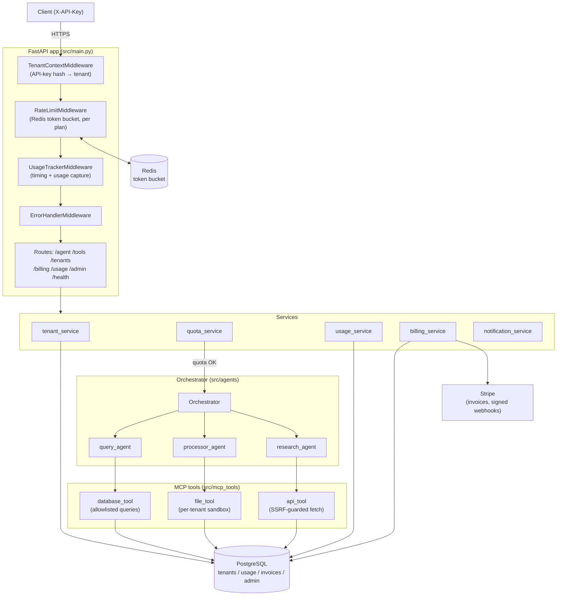

# Agent Platform SaaS

Multi-tenant SaaS platform for LangGraph agents with usage-based billing,
per-tenant rate limiting, and MCP tool support.

## Structure

- `src/` — application source code
- `tests/` — unit and integration tests
- `scripts/` — DB bootstrap and seed scripts
- `docker/` — Docker Compose and Dockerfile
- `docs/` — architecture, billing model, API reference

## Setup

```bash
cp .env.example .env
# fill in your values
pip install -r requirements.txt
docker compose up -d
uvicorn src.main:app --reload
```

## System Architecture

```text
                                 ┌─────────────────────┐
                                 │        Client        │
                                 │  (X-API-Key header)  │
                                 └──────────┬───────────┘
                                            │ HTTPS
                                            ▼
┌───────────────────────────────────────────────────────────────────────┐
│                         FastAPI app (src/main.py)                      │
│                                                                         │
│   Middleware chain (request order):                                    │
│   TenantContext ──▶ RateLimit ──▶ UsageTracker ──▶ ErrorHandler         │
│   (API-key hash   (Redis token   (times request,   (catches/formats    │
│    → tenant)        bucket per    records usage)     unhandled errors) │
│                      plan)                                             │
│                                                                         │
│   Routes: /agent  /tools  /tenants  /billing  /usage  /admin  /health   │
└───────────────┬───────────────────────────────────────────┬───────────┘
                │                                             │
                ▼                                             ▼
   ┌─────────────────────────┐                  ┌───────────────────────┐
   │        Services          │                  │   Redis (rate limit,  │
   │  tenant / quota / usage / │◀────────────────▶│   token bucket)       │
   │  billing / notification   │                  └───────────────────────┘
   └────────────┬──────────────┘
                │ quota OK
                ▼
   ┌─────────────────────────┐
   │       Orchestrator        │
   │     (src/agents)          │
   │                            │
   │  ┌─────────┐ ┌───────────┐ │     ┌───────────────────────────┐
   │  │  query  │ │ processor │ │────▶│        MCP tools            │
   │  │  agent  │ │  / research│ │     │  database | file | api      │
   │  └─────────┘ └───────────┘ │     │ (sandboxed, SSRF-guarded)   │
   └─────────────┬──────────────┘     └───────────────┬─────────────┘
                 │ usage record written                │
                 ▼                                      ▼
   ┌─────────────────────────────────────────────────────────────┐
   │             PostgreSQL (tenants, usage, invoices, admin)       │
   └───────────────────────────────┬───────────────────────────────┘
                                   │ billing aggregation
                                   ▼
                      ┌─────────────────────────┐
                      │   Stripe (invoices,       │
                      │   signed webhooks)         │
                      └─────────────────────────┘
```



See [`docs/architecture.md`](docs/architecture.md) for the full data-flow
narrative and MCP tool details.
